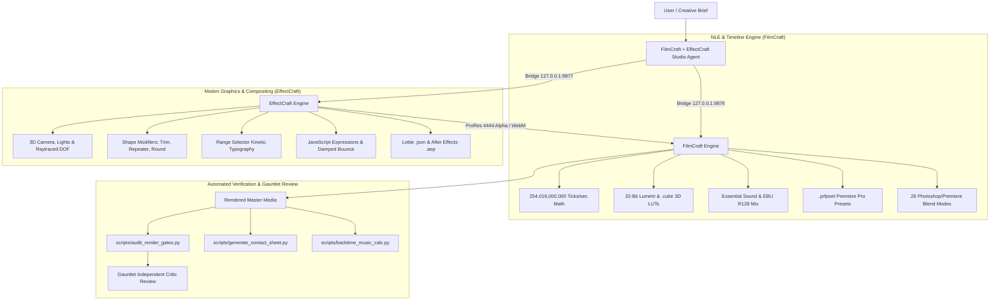
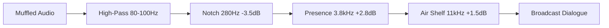

# FilmCraft + EffectCraft Studio Package

> **High-Performance Motion Picture, VFX & Audio Mastering Suite for Autonomous Coding & Creative Media Agents**

The **FilmCraft + EffectCraft Studio Package** (`filmcraft-effectcraft-studio`) is an end-to-end, production-grade video editing, compositing, motion design, and audio mastering framework. By pairing the non-linear timeline editing performance of **FilmCraft** with the procedural motion graphics, 3D compositing, and scripting depth of **EffectCraft**, this studio package empowers autonomous AI agents and human creators to craft broadcast-compliant, cinema-grade films while mathematically eliminating the tells of "AI visual slop."

---

## Table of Contents

1. [Dual-Engine Architecture](#dual-engine-architecture)
2. [Key Capabilities](#key-capabilities)
3. [The Motion Science: 12 Measured Eases](#the-motion-science-12-measured-eases)
4. [The 16 Reusable Motion Mechanisms](#the-16-reusable-motion-mechanisms)
5. [Intelligent Rough-Cut & Audio Mastering](#intelligent-rough-cut--audio-mastering)
6. [The Gauntlet Protocol: Quality Gates & Slop Autopsy](#the-gauntlet-protocol-quality-gates--slop-autopsy)
7. [Automated CLI Validation Tools](#automated-cli-validation-tools)
8. [External Asset Library Ingestion](#external-asset-library-ingestion)
9. [Directory Structure](#directory-structure)
10. [Quickstart & Workflow Checklist](#quickstart--workflow-checklist)

---

## Dual-Engine Architecture

The studio operates across dual engine instances via unified JSON command protocols, accessible through native MCP servers, TCP bridge control ports, or headless CLI environments:



### Connection Protocols
* **FilmCraft Control Channel:** `127.0.0.1:9876` (`filmcraft --control 9876`, token in `FILMCRAFT_CONTROL_TOKEN`)
  * Documentation: [`references/filmcraft-mcp-playbook.md`](./references/filmcraft-mcp-playbook.md)
* **EffectCraft Control Channel:** `127.0.0.1:9877` (`effectcraft --control 9877`, headless with `effectcraft-cli mcp --gpu`)
  * Documentation: [`references/effectcraft-mcp-playbook.md`](./references/effectcraft-mcp-playbook.md)

---

## Key Capabilities

### FilmCraft Timeline Engine
* **Exact Integer Time Math:** Eliminates floating-point rounding drift by calculating all media boundaries, cut points, keyframes, and durations using exact 64-bit integer ticks:
  $$\text{Ticks per Second} = 254,016,000,000$$
  Divisible without remainder across all broadcast framerates ($23.976, 24, 25, 29.97, 30, 50, 59.94, 60, 120\text{ fps}$).
* **32-Bit Floating-Point Lumetri Color:** Native support for 3D Color Lookup Tables (`.cube`), S-curve luma contrast, white/black point anchors, saturation, and optical vignette.
* **Essential Sound & Dialogue Ducking:** Automatic classification of clips into `dialogue`, `music`, and `sfx`, with automated EBU R128 music ducking ($-12\text{ dB}$ attenuation under speech).
* **Premiere Pro `.prfpset` Ingestion:** Direct native import of Adobe Premiere Pro preset packages (`Effects ▸ Presets`).
* **26 Blending Modes:** Full parity with Photoshop and Premiere Pro (Screen, Add, Multiply, Overlay, Color Dodge, Soft Light, etc.).

### EffectCraft Compositing & VFX Engine
* **308 Built-in GPU Effects:** High-speed match-name effect library across Blur, Distort, Generate, Perspective, Transition, and Color Correction categories.
* **Procedural Vector Shape Layers:** Nested shape groups with non-destructive modifiers: `Trim Paths`, `Repeater`, `Round Corners`, `Wiggle Paths`, and boolean `Merge Paths`.
* **Kinetic Typography with Range Selectors:** Staggered per-character, per-word, and per-line reveals with precise position, opacity, scale, and tracking offsets.
* **3D Cameras & Raytraced Depth of Field:** 1-node and 2-node cameras, variable focal lengths, aperture-driven bokeh blur, parallel/spot/point lights, and raytraced diffusion shadows.
* **ECMAScript Expression Engine:** Full JavaScript execution parity including `wiggle()`, `loopOut("cycle")`, cross-layer coordinate tracking (`toComp`), and physical harmonic overshoot.
* **Lottie & After Effects Round-Tripping:** Native import of vector Lottie (`.json`, `.lottie`) and After Effects (`.aep`, `.aepx`) project files; transparent alpha export (Apple ProRes 4444 / WebM VP9) directly into FilmCraft timelines.

---

## The Motion Science: 12 Measured Eases

Empirical analysis of 53 human-crafted, award-winning commercial films (~4,300 measured motion events) established the craft laws of realistic velocity and timing. Never use default linear interpolation or generic symmetric eases.

### Core Craft Laws
1. **Entries Decelerate (58% Ease-Out):** Elements arriving on screen to be read spend 50%–60% of their spatial distance in the first 10%–20% of the movement duration, settling with an asymptotic long tail (`snapSettle`, `softLand`).
2. **Exits Accelerate (37% Ease-In):** Departing cards accelerate sharply off screen (`accelExit`, `crashOut`). The eye must never wait for an exiting element.
3. **Never Grow from 0%:** Elements scaling from zero look artificial. Professional motion arrives by decelerating from oversize (`~3.5x` with `snapSettle`), entering from off-screen at high velocity, or unmasking via `Trim Paths`.
4. **Median Motion Duration:** `10 frames (0.33s at 30fps / 0.17s at 60fps)`.

### The 12 Measured Curves

| Curve Name | Duration (30fps) | EffectCraft Out (Inf / Spd) | EffectCraft In (Inf / Spd) | Cubic Bezier | Primary Role |
| :--- | :--- | :--- | :--- | :--- | :--- |
| **`snapSettle`** | 11f (0.37s) | `85.0% / 0.0` | `15.0% / 0.1` | `(0.12, 0.54, 0.25, 1.0)` | Primary hero arrival (54% travel in first 10% time) |
| **`softLand`** | 12f (0.40s) | `72.0% / 0.0` | `28.0% / 0.0` | `(0.16, 1.0, 0.30, 1.0)` | Typography lines, secondary UI cards, panels |
| **`crashIn`** | 10f (0.33s) | `78.0% / 0.0` | `18.0% / 2.8` | `(0.19, 1.18, 0.22, 1.0)` | Tactile stamps, map pin drops, tactile badges |
| **`whip`** | 7f (0.23s) | `90.0% / 0.0` | `10.0% / 0.0` | `(0.08, 0.85, 0.15, 1.0)` | Whip pan transitions, high-speed lateral sweeps |
| **`glide`** | 10f (0.33s) | `55.0% / 0.0` | `35.0% / 0.0` | `(0.25, 0.75, 0.45, 1.0)` | Subtle camera reframing during active reading |
| **`cruise`** | 9f (0.30s) | `33.3% / 1.0` | `33.3% / 1.0` | `linear` | Continuous background drift, Ken Burns scaling |
| **`softInOut`** | 9f (0.30s) | `42.0% / 0.1` | `42.0% / 0.1` | `(0.42, 0.0, 0.58, 1.0)` | Opacity crossfades, defocus blur ramps |
| **`popOver`** | 15f (0.50s) | `65.0% / 0.0` | `25.0% / 1.6` | `(0.34, 1.25, 0.64, 1.0)` | Interactive micro-overshoot, toggle switches |
| **`bounceHard`**| 22f (0.73s) | `50.0% / 0.0` | `20.0% / 3.2` | `(0.22, 1.48, 0.38, 1.0)` | Cartoon spring (use at most once per film) |
| **`gentleIn`** | 9f (0.30s) | `20.0% / 0.0` | `65.0% / 1.8` | `(0.45, 0.05, 0.70, 0.40)` | Anticipation before transition |
| **`accelExit`** | 13f (0.43s) | `15.0% / 0.0` | `82.0% / 2.6` | `(0.55, 0.0, 0.90, 0.35)` | Standard exit for title cards, panels, and text |
| **`crashOut`** | 17f (0.57s) | `10.0% / 0.0` | `92.0% / 4.0` | `(0.70, 0.0, 1.0, 0.20)` | Hard acceleration into a cut or shutter blackout |

👉 Presets file: [`presets/effectcraft-ease-presets.json`](./presets/effectcraft-ease-presets.json)  
👉 Full Guide: [`references/measured-motion-and-mechanisms.md`](./references/measured-motion-and-mechanisms.md)

---

## The 16 Reusable Motion Mechanisms

Extracted from 28 high-end launch films (Apple, Stripe, Linear, Replit, Wonder, Bolt):

1. **Foreground Fly-Through:** Foreground headline/logo scales past camera (`100% -> 450%`), revealing pre-positioned Scene B.
2. **Logo-as-Portal:** Negative space of brand mark expands into the subsequent scene's matte.
3. **Selection ➔ Expansion:** Active thumbnail expands into full-screen workspace.
4. **Materializing Result:** Structural shell lands first, then data and text cascade.
5. **Persistent Rails:** Structural layout lines persist while interior content swaps.
6. **Continuous Canvas:** Camera tracks across a continuous surface; active item stays sharp while neighbors blur.
7. **Artifact Ring:** Supporting badges orbit a central anchor sentence.
8. **Card Stack / Fan:** Multi-layer cards stack, fan out, and resolve to one leader.
9. **Perspective Fold:** 3D panel folds down into a luminous horizontal line; new panel unfolds upward.
10. **Exploded Layers:** Hardware or UI separates along Z-axis into floating layers, then recombines.
11. **Registered Decomposition:** Source graphic decomposes into categorical buckets while anchored.
12. **Wall ➔ One Actor:** Dense data grid recedes into dark background, spotlighting a single winning metric.
13. **Carousel Emphasis:** Rotating 3D carousel with illuminated center card and dimmed receding neighbors.
14. **Colour-Field Takeover:** Organic gradient wash marks a major chapter break.
15. **Tile Wipe:** Symmetrical checkerboard or vertical ribbon reveal.
16. **Request ➔ Picker ➔ Result:** Tactile interactive cursor click, menu dropdown, and confirmation.

👉 Presets file: [`presets/effectcraft-motion-presets.json`](./presets/effectcraft-motion-presets.json)

---

## Intelligent Rough-Cut & Audio Mastering

### Talking-Head Editorial Rules
* **Retake Pruning:** Automatically select the final complete take when a speaker repeats a line. Strip trailing abandoned takes.
* **Spoken Editor Notes (`transcript.inspect`):** Detect and slice out verbal directions (*"cut here"*, *"roll screen recording"*), dropping a timeline marker on the seam.
* **Pacing Handles:** Enforce `0.4s–0.5s` in-pad before speech and `0.5s–0.7s` out-pad after the final word.

### 5-Band Diagnostic Voice EQ Recipe

* **High-Pass (18 dB/oct):** `80–100 Hz` (cuts sub rumble & handling noise).
* **Boxy Mud Notch:** `250–350 Hz` (Q 1.8, `-3.0 dB to -4.5 dB`).
* **Speech Presence Boost:** `3.2–4.8 kHz` (Wide Q 1.0, `+2.5 dB to +3.5 dB` restores intelligibility).
* **Air & Sheen:** `10–12 kHz` High-Shelf (`+1.5 dB`).

### Musical Back-Timing Mathematics
Never arbitrarily chop a music track and fade it out mid-bar. Calculate the track's **natural resolving final hit** against the end card arrival:

$$\text{sourceIn} = \text{hit}_{\text{source}} - \text{card}_{\text{timeline}}$$

$$\text{sourceOut} = \text{sourceIn} + \text{film}_{\text{duration}}$$

👉 Full Guide: [`references/rough-cut-and-audio-mastering.md`](./references/rough-cut-and-audio-mastering.md)

---

## The Gauntlet Protocol: Quality Gates & Slop Autopsy

### Core Law: Builder ≠ Judge
An editing agent cannot certify its own output. Quality is verified numerically by automated scripts and visually by independent critic inspection.

### The G0–G5 Quality Gates

| Gate | Target Criteria | Tool |
| :---: | :--- | :--- |
| **G0** | Decode ok, duration match $\pm 0.35$s, audio present, non-blank | `scripts/audit_render_gates.py` |
| **G1** | Captured UI $\ge 55\%$ frame width; text height $\ge 4\%$ frame height | `scripts/generate_contact_sheet.py` |
| **G2** | Zero runs of $>3$ consecutive flat/motionless frames | `scripts/audit_render_gates.py` |
| **G3** | Static end-hold $\le 1.4$s; final shot $\le 25\%$ total film | `scripts/audit_render_gates.py` |
| **G4** | Single dominant focal point per beat | `scripts/generate_contact_sheet.py` |
| **G5** | Zero Slop: No corner labels (C1), counters (C3), metadata (C4), deck layouts (D1), typed headlines (T1), or vibe-coded cards (V1-V5) | `scripts/audit_render_gates.py` / `lint.mjs` |
| **AUDIO** | Integrated $-14.0\text{ LUFS} \pm 1.0$; True Peak $\le -1.0\text{ dBTP}$ | `scripts/audit_render_gates.py` |

### Slop Autopsy (25 Rejection Patterns)
* **C1–C7 (Page Chrome):** Corner labels, tracked-caps tags, chapter counters (`02 / SPEAK`), fake metadata (`60 FPS`, `BPM 120`), hairlines, and kickers stacked over headlines.
* **D1 (Slide-Deck Layout):** Left headline block with small floating screenshot on right.
* **T1 (Typewriter Headlines):** Main headlines typed letter-by-letter with a blinking cursor.
* **V1–V5 (Vibe-Coded UI Cards):** Generic greetings (*"Good morning"*), fake metric cards (*"Revenue • $12,450"*), status dots, and unbranded Tailwind zinc grey slop.

👉 Full Guide: [`references/gauntlet-critic-and-gates.md`](./references/gauntlet-critic-and-gates.md)

---

## Automated CLI Validation Tools

The studio includes three standalone, dependency-resilient Python CLI scripts:

### 1. `audit_render_gates.py`
Runs complete automated quality gate verification on exported video files:
```bash
python scripts/audit_render_gates.py Master.mp4 --expect-duration 26.5 --strict --out-report gates.json
```
* Supports both `ffprobe`/`ffmpeg` and native `filmcraft-cli probe` fallback.
* Verifies G0 (Render Health), G2 (Dead Frame sequences), G3 (End-card hold $\le 1.4$s), and EBU R128 ($-14.0\text{ LUFS}$, True Peak $\le -1.0\text{ dBTP}$).

### 2. `generate_contact_sheet.py`
Extracts evenly spaced diagnostic frames and compiles an organized visual inspection contact sheet:
```bash
python scripts/generate_contact_sheet.py Master.mp4 --out contact_sheet.jpg --cols 5 --rows 2 --width 1920
```

### 3. `backtime_music_calc.py`
Analyzes audio transients to calculate sample-accurate musical back-timing:
```bash
# 1. Scan candidate final downbeats in the source track
python scripts/backtime_music_calc.py music_track.wav --list-hits

# 2. Compute exact sourceIn and render pre-trimmed slice
python scripts/backtime_music_calc.py music_track.wav --film 26.5 --card 22.5 --hit 96.018 --out trimmed_score.wav
```

---

## External Asset Library Ingestion

To ensure visual richness without generic AI cliches, integrate verified external assets:

| Source | File Types | Usage in Studio |
| :--- | :--- | :--- |
| **Mixkit** | `.prfpset`, `.aep`, `.wav` | Native FilmCraft transition presets (`Effects ▸ Presets`) and acoustic SFX (whooshes, risers, sub hits) placed on `A2`/`A3`. |
| **LottieFiles** | `.json`, `.lottie` | Infinite-resolution vector animations imported into EffectCraft via `File ▸ Import ▸ Lottie…`. |
| **Luttie / ON1** | `.cube` | Technical Log-to-Rec.709 transforms and creative 3D LUTs applied at 30%–60% opacity. |
| **CinePacks** | `.mp4`, `.mov` | 35mm film burns, light leaks, and lens flares layered on `V2`/`V3` with `Screen` or `Add` blend modes. |

👉 Full Guide: [`references/external-asset-integration.md`](./references/external-asset-integration.md)

---

## Directory Structure

```text
filmcraft-effectcraft-studio/
├── SKILL.md                               # Agent orchestration skill specification
├── README.md                              # This document
├── references/
│   ├── filmcraft-mcp-playbook.md          # FilmCraft MCP, Tick math, Lumetri, Sound, .prfpset, Blends
│   ├── effectcraft-mcp-playbook.md        # EffectCraft MCP, 308 effects, 3D Camera, Expressions, Lottie
│   ├── measured-motion-and-mechanisms.md  # 12 Measured Eases + 16 Reusable Motion Mechanisms
│   ├── rough-cut-and-audio-mastering.md   # Retake pruning, 5-band EQ recipes, musical back-timing
│   ├── genre-editing-library.md           # 8 production genre matrix (SaaS, Event, Story, Ad, Vlog)
│   ├── gauntlet-critic-and-gates.md       # G0–G5 Quality Gates, Slop Autopsy (C1–C7, D1, T1, V1–V5)
│   └── external-asset-integration.md      # Mixkit, LottieFiles, Luttie, CinePacks integration
├── presets/
│   ├── effectcraft-ease-presets.json      # 12 Velocity curves for EffectCraft (.ecpreset / Keyframe Velocity)
│   ├── effectcraft-motion-presets.json    # Snap zoom, whip pan, 3D tilt, kinetic text, bounce templates
│   └── filmcraft-command-batches.json     # J/L-cuts, Screen Studio zoom, Lumetri S-curve, auto-ducking
└── scripts/
    ├── audit_render_gates.py              # Automated CLI quality gate and EBU R128 loudness validator
    ├── generate_contact_sheet.py          # Visual diagnostic contact sheet grid generator
    └── backtime_music_calc.py             # Musical downbeat transient detector and back-timing solver
```

---

## Quickstart & Workflow Checklist

When assigned an editing, compositing, or promo video task:

1. **Pre-Production Audit:** Inspect source footage specs via `sequence_inspect` or `doc_inspect`.
2. **Rough-Cut Continuity:** Lay down primary `V1` narrative footage running at 100% natural playback speed. **Enforce Zero Cuts** under graphic title cards while they are active on screen.
3. **Motion Graphics (EffectCraft):** Build complex vector badges, 3D layer tilt, or kinetic text in EffectCraft using `Range Selector` and `snapSettle` ease. Export transparent ProRes 4444 to FilmCraft `V3`.
4. **Cinematic Grading:** Apply 32-bit floating-point Lumetri grade: subtle S-curve contrast, Rec.709 white/black point balance, and optical lens vignette.
5. **Sound Design & Mastering:**
   * Back-time music track using `scripts/backtime_music_calc.py` so the final resolution lands directly on the end-card transition.
   * Pre-align SFX transients so impacts hit sample-accurately on visual cut frames.
   * Calibrate Master bus to $-14.0\text{ LUFS} \pm 1.0\text{ LU}$ and True Peak $\le -1.0\text{ dBTP}$.
6. **Automated Gauntlet Audit:**
   ```bash
   python scripts/audit_render_gates.py Master.mp4 --expect-duration <dur> --strict
   python scripts/generate_contact_sheet.py Master.mp4 --out contact_sheet.jpg
   ```
7. **Delivery:** Commit project with `file.save`, export Master MP4 (CRF 16, H.264 High, 60fps), and provide verification report with clickable file links.
