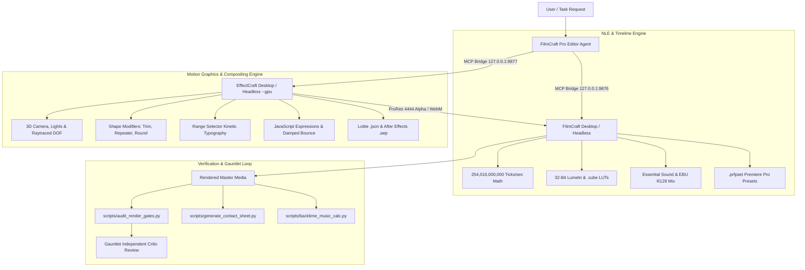

# FilmCraft + EffectCraft Pro Editor Studio Package

A unified, human-grade motion picture and motion graphics production suite. By pairing the non-linear timeline editing power of **FilmCraft** with the compositing and 3D animation depth of **EffectCraft**, this skill delivers broadcast-compliant, cinema-grade films while mathematically eliminating the tells of AI visual slop.

---

## 1. Studio Architecture & Engine Control

The studio operates across dual engine instances or headless CLI services:



### Protocol Ports & Bridge Commands
* **FilmCraft Control Channel:** `127.0.0.1:9876` (`filmcraft --control 9876`, token in `FILMCRAFT_CONTROL_TOKEN`)
  👉 Reference: [`references/filmcraft-mcp-playbook.md`](./references/filmcraft-mcp-playbook.md)
* **EffectCraft Control Channel:** `127.0.0.1:9877` (`effectcraft --control 9877`, headless with `effectcraft-cli mcp --gpu`)
  👉 Reference: [`references/effectcraft-mcp-playbook.md`](./references/effectcraft-mcp-playbook.md)

---

## 2. Mathematical Motion & The 12 Measured Eases

Every animation must obey empirical physics measured across 53 high-end commercial films (never use generic linear interpolation or symmetric eases):

* **Entries Decelerate (58% Ease-Out):** Elements arrive fast, spending 54% of spatial travel in the first 10% of time, settling via asymptotic long tails (`snapSettle`, `softLand`).
* **Exits Accelerate (37% Ease-In):** Departing cards accelerate sharply off screen (`accelExit`, `crashOut`). The eye never waits for an exit.
* **No Growth from 0%:** Never scale from zero. Decelerate from oversize (`~3.5x` with `snapSettle`), enter from off-screen, or unmask via `Trim Paths`.
* **Median Move Duration:** 10 frames (0.33s at 30fps / 0.17s at 60fps).

👉 Ready-to-Use Presets:
* [`presets/effectcraft-ease-presets.json`](./presets/effectcraft-ease-presets.json): 12 measured curves mapped to EffectCraft Velocity & Bezier.
* [`presets/effectcraft-motion-presets.json`](./presets/effectcraft-motion-presets.json): Snap zoom, whip pan, 3D card tilt, kinetic text reveal, inertial bounce.
* [`presets/filmcraft-command-batches.json`](./presets/filmcraft-command-batches.json): J/L-cuts, Screen Studio auto-zoom, Lumetri S-curves, EBU R128 ducking.
👉 Full Guide: [`references/measured-motion-and-mechanisms.md`](./references/measured-motion-and-mechanisms.md)

---

## 3. The 16 Reusable Motion Mechanisms

1. **Foreground Fly-Through:** Foreground headline/logo scales past camera (`100% -> 450%`), revealing pre-positioned Scene B.
2. **Logo-as-Portal:** Negative space of brand mark expands into the subsequent scene's matte.
3. **Selection ➔ Expansion:** Active thumbnail expands into full-screen workspace.
4. **Materializing Result:** Structural shell lands first, then data and text cascade.
5. **Persistent Rails:** Structural layout lines persist while interior content swaps.
6. **Continuous Canvas:** Camera tracks across a continuous surface; active item stays sharp while neighbors blur.
7. **Artifact Ring:** Supporting badges orbit a central anchor sentence.
8. **Card Stack / Fan:** Multi-layer cards stack, fan out, and resolve to one leader.
9. **Perspective Fold:** 3D panel folds down into a luminous horizontal line; new panel unfolds upward.
10. **Exploded Layers:** Hardware or UI separates along Z-axis into floating layers, then recombines.
11. **Registered Decomposition:** Source graphic decomposes into categorical buckets while anchored.
12. **Wall ➔ One Actor:** Dense data grid recedes into dark background, spotlighting a single winning metric.
13. **Carousel Emphasis:** Rotating 3D carousel with illuminated center card and dimmed receding neighbors.
14. **Colour-Field Takeover:** Organic gradient wash marks a major chapter break.
15. **Tile Wipe:** Symmetrical checkerboard or vertical ribbon reveal.
16. **Request ➔ Picker ➔ Result:** Tactile interactive cursor click, menu dropdown, and confirmation.

---

## 4. Intelligent Rough-Cut & Sound Engineering

* **Retake Pruning:** In multi-take talking-head footage, automatically select the final complete take. Strip false starts and restart cues.
* **Spoken Editor Notes (`transcript.inspect`):** Detect verbal directions (*"cut here"*, *"roll screen recording"*) and remove them, dropping a timeline marker on the seam.
* **Parametric Voice Repair EQ:**
  * High-Pass `80-100 Hz` (cut handling rumble).
  * Notch `250-350 Hz` by `-3.5 dB` (remove boxy mud).
  * Boost `3.2-4.5 kHz` by `+2.8 dB` (restore clarity from covered mics).
  * High-Shelf `10-12 kHz` by `+1.5 dB` (air).
* **Musical Back-Timing:** Align the music track's natural resolving downbeat to the visual arrival of the end card:
  $$\text{sourceIn} = \text{hit}_{\text{source}} - \text{card}_{\text{timeline}}$$
  Execute: `python scripts/backtime_music_calc.py <audio> --film <dur> --card <time> --hit <hit>`

👉 Full Guide: [`references/rough-cut-and-audio-mastering.md`](./references/rough-cut-and-audio-mastering.md)

---

## 5. The Gauntlet Protocol: Quality Gates & Slop Autopsy

An editor cannot self-certify an edit. All renders must pass the automated Gauntlet gates:

| Gate | Target | Tool |
| :---: | :--- | :--- |
| **G0** | Decode ok, duration match $\pm 0.35$s, audio present, non-blank | `scripts/audit_render_gates.py` |
| **G1** | Captured UI $\ge 55\%$ frame width; text height $\ge 4\%$ frame height | `scripts/generate_contact_sheet.py` |
| **G2** | Zero runs of $>3$ consecutive flat/motionless frames | `scripts/audit_render_gates.py` |
| **G3** | Static end-hold $\le 1.4$s; final shot $\le 25\%$ total film | `scripts/audit_render_gates.py` |
| **G4** | Single dominant focal point per beat | `scripts/generate_contact_sheet.py` |
| **G5** | Zero Slop: No corner labels (C1), counters (C3), metadata (C4), deck layouts (D1), typed headlines (T1), or vibe-coded cards (V1-V5) | `scripts/audit_render_gates.py` / `lint.mjs` |
| **AUDIO** | Integrated $-14.0\text{ LUFS} \pm 1.0$; True Peak $\le -1.0\text{ dBTP}$ | `scripts/audit_render_gates.py` |

👉 Full Guide: [`references/gauntlet-critic-and-gates.md`](./references/gauntlet-critic-and-gates.md)

---

## 6. External Asset Ingestion

Integrate verified external assets without stylistic conflict:
* **Mixkit:** `.prfpset` transitions (`Effects ▸ Presets`) and `.wav` acoustic sound design.
* **LottieFiles:** Vector `.json` / `.lottie` via EffectCraft `File ▸ Import ▸ Lottie…`.
* **Luttie / ON1 / IWLTBAP:** Technical Log transforms and creative `.cube` 3D LUTs at 30%–60% opacity.
* **CinePacks:** 35mm film burns, light leaks, and lens flares with `blendMode: "screen"` or `"add"` on `V2`/`V3`.

👉 Full Guide: [`references/external-asset-integration.md`](./references/external-asset-integration.md)

---

## 7. Execution Checklist for Any Editing Task

1. **Setup & Inspect:** Inspect footage metadata and sequence specs via `sequence_inspect` or `doc_inspect`.
2. **Rough-Cut & Continuity:** Assemble V1 footage at 100% natural playback speed. Ensure zero cuts under graphic title cards.
3. **Motion & Compositing:** For advanced overlays, composite in EffectCraft with 3D cameras and Range Selectors; export ProRes 4444 to FilmCraft `V3`.
4. **Color & Texture:** Apply Lumetri S-curve contrast and Rec.709 color balance.
5. **Sound Design & Mix:** Back-time music using `scripts/backtime_music_calc.py`. Pre-align SFX transients to cut boundaries. Calibrate master bus to -14.0 LUFS.
6. **Automated Gauntlet Audit:**
   ```bash
   python scripts/audit_render_gates.py Master.mp4 --expect-duration 26.5 --strict
   python scripts/generate_contact_sheet.py Master.mp4 --out contact_sheet.jpg
   ```
7. **Delivery:** Commit project with `file.save`, export Master MP4 (1080x1920 or 1920x1080, 60fps, CRF 16), and present clickable file links with audit report.
