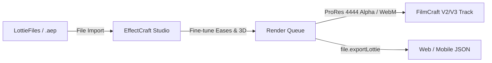

# EffectCraft MCP & Motion Graphics Playbook

## 1. Engine & MCP Connection Architecture

EffectCraft is a high-performance 2D/3D motion graphics and compositing engine engineered for After Effects parity, complete with JavaScript scripting, expressions, shape modifiers, 3D raytraced lighting, and native Lottie/.aep round-tripping.

### Connection Topologies
| Mode | Command Line Invocation | Description |
| :--- | :--- | :--- |
| **Live GUI Bridge** | `effectcraft --control 9877`<br>`effectcraft-cli --bridge 127.0.0.1:9877 mcp` | Real-time interactive sessions; desktop GUI mirrors all layer, camera, and keyframe changes live. |
| **Headless GPU** | `effectcraft-cli mcp --gpu` | High-speed headless rendering on dedicated GPU adapter. Ideal for background asset synthesis and exports. |
| **Headless CPU** | `effectcraft-cli mcp` | Portable, dependency-free in-memory rendering. |

---

## 2. Core Engine Command Architecture

Every operation in EffectCraft is accessible via JSON commands dispatched through `engine.execute` or MCP convenience tools:

### Discovery & Introspection Commands
* `command.list {filter?: string, enabledOnly?: boolean, schemas?: boolean}`: Returns all available command IDs, parameter docs, and JSON schemas.
* `command.describe {id: string}`: Full parameter definition and JSON schema for a specific command.
* `project.summary`: Returns open project path, composition count, footage items, and render queue status.
* `comp.info {comp?: string | number}`: Full composition settings (width, height, fps, pixel aspect ratio, duration, layer count, CTI time).
* `layer.tree {comp?: string, depth?: number}`: Complete hierarchical property tree of all layers in a composition, including property paths and UIDs.

### Mutation & Property Manipulation
* `prop.get {layer: string | number, path: string, time?: number}`: Queries property value, keyframe array, or expression.
* `prop.set {layer, path, value?, time?, timeBase?: "comp" | "layer", expression?}`: Sets a static value, keyframe, or JavaScript expression.
* `anim.savePreset {layer, properties: string[], path: string}`: Exports selected properties into a portable `.ecpreset` file.
* `anim.applyPreset {layer, path: string, time?: number}`: Applies an `.ecpreset` file at specified time.
* `file.exportLottie {comp, path: string, optimize?: boolean}`: Exports composition directly to vector Lottie JSON (`.json` or `.lottie`).

---

## 3. Layer Types & Composition Architecture

### 1. Shape Layers & Vector Modifiers
Shape layers support nested path groups and procedural modifiers:
* **Trim Paths (`ADBE Vector Filter - Trim`):**
  * `start` (0.0% to 100.0%)
  * `end` (0.0% to 100.0%)
  * `offset` (degrees or percentage)
  * Mode: Simultaneously or Individually
* **Repeater (`ADBE Vector Filter - Repeater`):**
  * `copies`: Number of duplicates
  * `offset`: Stagger offset
  * `transform`: Per-instance position, scale, rotation, start/end opacity
* **Round Corners (`ADBE Vector Filter - RC`):** Procedural corner radius smoothing.
* **Wiggle Paths (`ADBE Vector Filter - Roughen`):** Organic line turbulence.
* **Merge Paths (`ADBE Vector Filter - Merge`):** Boolean vector operations (Add, Subtract, Intersect, Exclude).

### 2. Kinetic Text & Range Selectors
EffectCraft supports multi-selector kinetic typography:
* Add Animator: `text.addAnimator {clip, name: "KineticReveal"}`
* Range Selector:
  * Units: Percentage (`0-100%`) or Index (Character count).
  * Based On: Characters, Characters Excluding Spaces, Words, Lines.
  * Shape: Square, Ramp Up, Ramp Down, Triangle, Round, Smooth.
  * Ease High & Ease Low: Non-linear character weighting.

### 3. 3D Cameras, Lights & Raytraced Depth of Field
* **Camera Types:** 1-Node (free-floating) or 2-Node (aimed at Point of Interest).
* **Camera Properties:**
  * `zoom` / `focalLength` (e.g. 50mm, 85mm portrait lens)
  * `depthOfField`: Enable/disable
  * `focusDistance`: Focal plane distance in pixels
  * `aperture`: Size of lens opening (determines bokeh blur radius)
  * `blurLevel`: Bokeh intensity percentage
* **Light Types:**
  * `Parallel`: Directional sunlight
  * `Spot`: Cone light with `coneAngle` and `coneFeather`
  * `Point`: Omni-directional bulb
  * `Ambient`: Global baseline illumination
  * `castShadows`: Raytraced soft shadows with `shadowDarkness` and `shadowDiffusion`.

---

## 4. Built-in 308 Effects Catalog

EffectCraft provides 308 GPU-accelerated effects with native match-names:
* **Blur & Sharpen:** `ADBE Gaussian Blur 2`, `ADBE Directional Blur`, `ADBE Radial Blur`, `ADBE Camera Lens Blur`
* **Color Correction:** `ADBE Lumetri Color`, `ADBE CurvesCustom`, `ADBE Color Balance (HLS)`, `ADBE Tint`
* **Distort:** `ADBE Optics Compensation`, `ADBE Displacement Map`, `ADBE Corner Pin`, `ADBE Turbulent Displace`
* **Generate:** `ADBE Ramp` (Gradient), `ADBE 4 Color Gradient`, `ADBE Stroke`, `ADBE Grid`
* **Perspective:** `ADBE 3D Glasses`, `ADBE Drop Shadow`, `ADBE Radial Shadow`
* **Transition:** `ADBE Linear Wipe`, `ADBE Radial Wipe`, `ADBE Card Dance`

---

## 5. JavaScript Expressions Engine

EffectCraft executes native ECMAScript with full After Effects scripting object model parity:

```javascript
// 1. Organic spatial wiggle (frequency Hz, amplitude px)
wiggle(3.5, 24.0);

// 2. Seamless loopOut for cycles
loopOut("cycle");

// 3. Coordinate linking across layers
target = thisComp.layer("Hero_Card");
target.toComp([target.width / 2, target.height / 2]);

// 4. Inertial Bounce (Physical harmonic oscillation)
n = 0;
if (numKeys > 0) {
  n = nearestKey(time).index;
  if (key(n).time > time) n--;
}
if (n > 0) {
  t = time - key(n).time;
  amp = 0.045;
  freq = 4.2;
  decay = 5.5;
  v = velocityAtTime(key(n).time - 0.001);
  value + v * amp * Math.sin(freq * t * 2 * Math.PI) / Math.exp(decay * t);
} else {
  value;
}
```

---

## 6. Lottie & After Effects Round-Trip Workflow



1. **Importing:**
   * `File ▸ Import ▸ Lottie…` (`.json`, `.lottie`) parses vector shape layers and transforms them into native EffectCraft editable shapes.
   * `File ▸ Import ▸ File…` (`.aep`, `.aepx`) imports full After Effects composition trees with layer hierarchies intact.
2. **Exporting Alpha Overlays to FilmCraft:**
   * Render Queue format: **Apple ProRes 4444** (with `channels: "rgb_alpha"`, `depth: "millions_colors_plus"`) or **VP9 WebM** with transparency.
   * Place the rendered file on FilmCraft `V2` or `V3` track above the primary `V1` B-roll footage.
   * The transparent background automatically overlays with pixel-perfect anti-aliasing.
