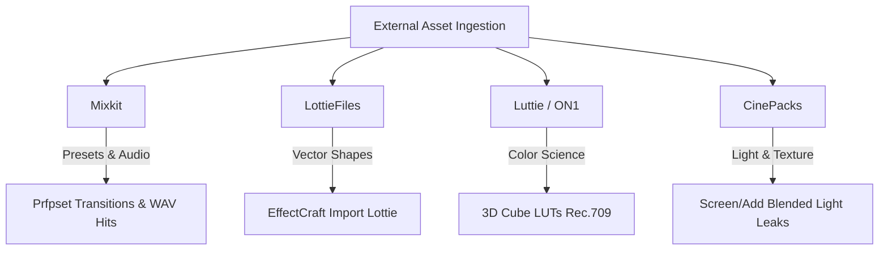

# External Asset & Preset Integration Guide

## 1. The 4 Standard Free Asset Sources

To avoid generic AI visual slop, human-grade motion editors integrate authentic physical textures, verified LUTs, and vector animations from four non-overlapping free libraries:

---

## 2. Source-by-Source Integration Rules

### 1. Mixkit (`.prfpset`, `.aep`, `.wav`)
* **Primary Utility:** Transition presets, motion graphic titles, and acoustic SFX (whooshes, risers, sub impacts).
* **Local Storage Standard:**
  * Presets: `%APPDATA%\ArtCraft\FilmCraft\Effect Presets\Mixkit\`
  * SFX: `<project_dir>/audio/sfx/`
* **Workflow:**
  * Import `.prfpset` transitions directly into FilmCraft (`Effects ▸ Presets ▸ Import`).
  * For `.wav` sound effects, always check peak levels and apply `lowpass(2400Hz)` filtering to remove artificial high-frequency hiss before placing on `A2`/`A3`.

### 2. LottieFiles (`.json`, `.lottie`)
* **Primary Utility:** Clean, infinite-resolution vector iconography, status checkmarks, payment flows, and animated UI elements.
* **Workflow:**
  1. Download `.json` or `.lottie` vector animation.
  2. In **EffectCraft**, select `File ▸ Import ▸ Lottie…`.
  3. EffectCraft automatically translates Lottie nodes into native Shape Layers with keyframed `Trim Paths`, `Scale`, and `Color`.
  4. Customize brand colors (`Fill ▸ Color`) and apply `snapSettle` or `softLand` easing to the timing.
  5. Render out with Alpha (ProRes 4444 or WebM VP9) and place on FilmCraft `V3` track.

### 3. Luttie / ON1 / IWLTBAP (`.cube`)
* **Primary Utility:** Professional 3D Color Lookup Tables (33x33x33 or 65x65x65) for cinematic color grading.
* **Workflow:**
  * **Input LUT (Technical Transform):** Applied to flat Log profiles (Sony S-Log3, Canon C-Log, D-Log) to map sensor data into broadcast standard Rec.709 colorspace with correct gamma 2.4.
  * **Creative Look LUT:** Applied in FilmCraft Lumetri Color panel:
    * Set intensity / opacity to **30%–60%** (never 100% to prevent crushed shadows or clipped highlights).
    * Check waveform monitor to ensure shadows sit comfortably between 5%–15% IRE and highlights do not exceed 95% IRE.

### 4. CinePacks Free Packs (`.mp4`, `.mov`)
* **Primary Utility:** Organic optical imperfections (anamorphic lens flares, 35mm film burns, subtle light leaks, subtle grain plates).
* **Workflow:**
  1. Place the CinePacks video clip on FilmCraft track `V2` or `V3` directly spanning a transition seam.
  2. Set the clip's **Blend Mode** (`blendMode`) to:
     * `Screen` (for black-background light leaks and flares).
     * `Add` (for high-contrast energy bursts).
     * `Overlay` or `Soft Light` (for 35mm grain plates).
  3. Set clip opacity to **40%–75%** so the effect enhances the underlying footage without overpowering the viewer's focus.
